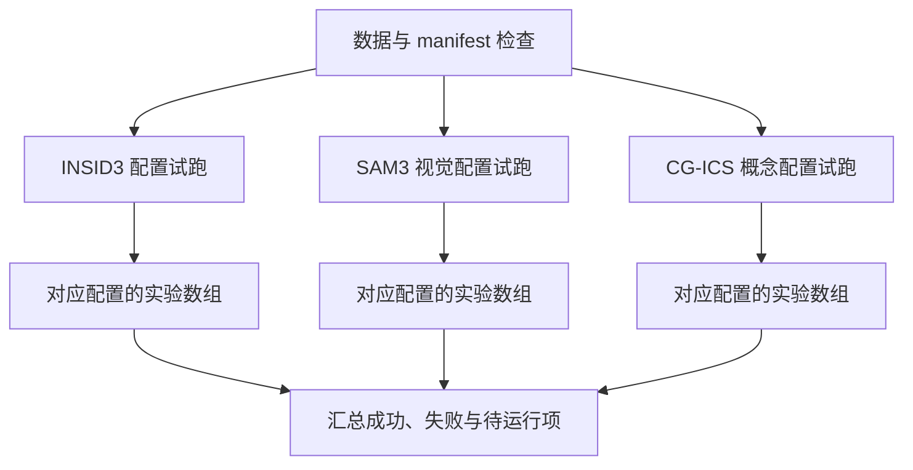

# 并行运行：一次提交，按依赖执行

状态：调度代码与合成测试已实现；没有在公司的 Slurm 或 GPU 上执行。这里不把当前容器配置当作 A*STAR 配置。

## 这次准备了什么

- `configs/suite.initial.json`：完整第一批配置。COCO 4 folds、LVIS 10 folds。
- `configs/suite.pilot.json`：同一配置集合的少量样本版本，用于实际显存、吞吐和接口检查；不能当作正式成绩。
- 36 个配置，含两种原版、组件开关、DINOv3/DINOv2/SAM3 features × 两种处理、参数分析。
- 标准 cohort：COCO 每 fold 请求 1000 queries，LVIS 每 fold 请求 2300 queries，1-shot。
- reference cohort：每 fold 请求 500 queries，每 query 50 个不同 references；实际可用数量不足时按 loader 规则取全部并记录，不重复伪装独立 reference。
- component cohort：初始每 fold 100 queries × 3 references，用相同 cohort 比较完整版本与所有对应消融。这个工作量是可调整的初始分析 subset，不是项目规模上限。
- 所有数据名与 fold 都明确写在 manifest 中。原始作者协议与本项目统一原图分辨率、固定配对的协议分开记录。

初始完整计划包含 42 份 manifests、36 个 smoke tasks、1,484 个正式 job tasks；请求 episode 总数上限估计 896,800（稀有类别可用 references 不足会下降）。这不是运行完成的数字。每个任务包含多个 episodes，而非每张图启动一次模型。模型大小/分辨率/组件参数是配置，不额外冒充独立方法。

## 一次提交的依赖



每种资源的 smoke array 结束后启动其生产 array；每个生产任务只接受自己对应配置的 smoke PASS。一个可选 backbone 失败不会让另一个成功配置继续冒险，也不会阻止其他成功配置运行。失败配置的任务会记录失败并立即退出。Slurm 使用 `--kill-on-invalid-dep=yes` 处理无法满足的依赖，避免无限悬挂；实际集群 Slurm 版本仍需验证。

## 服务器配置

先运行只读检查（在登录节点可查调度规则；分配节点内还应记录实际 GPU）：

```bash
python3 scripts/probe_cluster.py --output cluster_probe.json
python3 scripts/probe_environment.py > environment.json
```

复制 `configs/cluster.example.json` 为自己的 `configs/cluster.local.json`，填写实际的 `account`、`partition`、`time`、必要的 `qos`，以及 `max_parallel`。未填写时可以生成计划，但不会提交任务。每个资源 profile 可以覆盖这些字段；CPU preflight 也可以指定独立 partition。

`max_parallel` 是**每个资源数组**允许同时运行的任务数，不是整个套件共用一个总数。可以分别设置 `resources.insid3.max_parallel`、`resources.cgics_visual.max_parallel`、`resources.cgics_mllm.max_parallel`。最大请求 GPU 数约为 `insid3并行数 + visual并行数 + 2×concept并行数`，最后由 Slurm 的真实配额、QOS、可用资源决定分配。代码不会扫描全部可见 GPU 后占满。

环境和大文件位于你选定的项目外运行目录，例如：

```bash
export ICS_RUNTIME="/your/project-storage/ce6190-ics-runtime"
```

必须先完成环境、源码、数据和权重准备。`launch_suite` 不会隐式联网下载模型。preflight 会按 suite 中的明确 recipe 创建缺失的 manifests，复用已有文件并校验；模型 assets 在各自 smoke 中检查，不因一个可选 checkpoint 缺失阻塞其他模型。

## 查看并一次提交

```bash
python3 scripts/launch_suite.py \
  --suite configs/suite.initial.json \
  --cluster configs/cluster.local.json \
  --run-dir "$ICS_RUNTIME/runs/batch-001"
```

默认只写 `plan.json`、冻结配置并显示任务数。执行已确认的计划：

```bash
python3 scripts/launch_suite.py \
  --suite configs/suite.initial.json \
  --cluster configs/cluster.local.json \
  --run-dir "$ICS_RUNTIME/runs/batch-001" \
  --submit
```

同一个 run directory 重复执行提交命令会复用已保存 job IDs，不会重复提交整套任务。更改配置必须使用新 run directory。提交过程中断后已记录的部分会复用；极少数“Slurm 已接收，但客户端未收到 job ID”的情况需要查 `squeue/sacct`，不能盲目重试。

```bash
cat "$ICS_RUNTIME/runs/batch-001/submission.json"
squeue -u "$USER"
python3 scripts/launch_suite.py worker \
  --plan "$ICS_RUNTIME/runs/batch-001/plan.json" --phase collect
```

收集操作读取已有结果，不重跑模型，调用统一分析脚本输出 `analysis/`。collector 可以在部分任务失败时运行，显式保留 failure/pending 覆盖率。

## CG-ICS 的 MLLM 怎么并行

默认 `cgics_mllm` 为每个 job 请求 2 张 GPU：一张运行 SAM3，另一张运行该 job 自己的 vLLM。**这是隔离测量的请求配置，不是已经验证的显存最低要求。**如果 MLLM 需要 tensor parallel，可增加该 profile 的 GPU 数；第一张给 SAM3，其余给 vLLM。

每个任务启动本地、仅绑定 `127.0.0.1` 的 server，等待 `/health` 成功，再运行实验；结束时关闭自己的 server。不同任务不共用一个端口，也不共用 MLLM 进程。重型环境分离：`envs/insid3`、`envs/cgics`、`envs/mllm`。使用 SAM3 features 的 INSID3 配置在 `cgics_visual` 环境运行。

记录 vLLM 启动时间、runner 时间、实际模型调用统计。runner 的 torch GPU 峰值只覆盖它自己的进程；调度器另以约 1 秒间隔采样 GPU compute processes，按自己启动的 runner／vLLM 及其子进程归属显存；不会把同设备其他任务的显存当成自己的。进程采样峰值是下界，不冒充精确 allocator peak，也不把不同时间的各设备峰值求和称为瞬时峰值。

如确实要共享已有 server，设置该 profile 的 `mllm_mode: external` 与 `mllm_endpoint`。此时应把 `gpus` 改成仅 SAM3 的分配数量，并在结果中说明外部 server 的显存、排队和争用没有被单个 worker 完整测量。远程 endpoint 默认禁止；明确设置 `allow_remote_mllm: true` 才会允许把图像发往该服务。

## 在已分配 GPU 的节点本地运行

```bash
python3 scripts/launch_suite.py \
  --suite configs/suite.pilot.json \
  --cluster configs/cluster.local.json \
  --run-dir "$ICS_RUNTIME/runs/local-pilot-001" \
  --backend local --gpus 0,1,2,3 --submit
```

这里的 GPU IDs 必须来自你已取得的实际 allocation；脚本不会替你申请资源。设备池为每个任务分配互不重叠的设备；同时满足每类的 `max_parallel`。Slurm 提交模式应优先使用，它不需要手动列 GPU IDs。

## 失败与续跑

- 每个 task 有 `jobs/<task-id>/status.json`、`runner.log`、必要时 `vllm.log`、`gpu_memory.json`。
- 预测与逐 episode 结果位于 `results/<experiment-id>/<manifest-id>/`，shards 共用同一 run 输出目录并写独立记录。
- 自动启动使用 `--resume`，已有成功记录不会重跑；失败记录不自动重试，避免反复消耗算力。需要重试时使用 runner 的 `--resume --retry-failed`，并保留原先失败记录的审计链。
- `running.lock` 用于避免相同 task 同时执行。节点被杀或断电可能留下 lock；先核实没有运行中的相同 job，再人工移除对应 stale lock。
- Slurm 时长取实际 QOS 限制；超过时长不是模型结论。用 pilot 测到的吞吐决定后续 `shards` 和 job walltime。

同一批任务排队／运行期间，不要在服务器上覆盖或更新它使用的 checkout；新的代码版本应使用独立目录和新的 run directory。runner 会记录并检查代码／配置／权重绑定，但不能用一次 Git 更新为已排队任务提供不可变源码快照。

E7 案例与困难条件分析使用已保存预测和逐样本结果，不必为画图重复 GPU 推理。没有可靠遮挡标注时，不能凭低 IoU 自动宣称“遮挡导致失败”。

## 第二批单独提交

`configs/suite.phase2.json` 复用同一 runner／模型配置，包含 FSS-1000、SUIM、ISIC、iSAID 的完整两方法及一组组件对照；它独立于第一批的数据就绪检查，不会因为第二批尚未准备好阻塞 COCO／LVIS。

```bash
python3 scripts/launch_suite.py \
  --suite configs/suite.phase2.json \
  --cluster configs/cluster.local.json \
  --run-dir "$ICS_RUNTIME/runs/phase2-001" \
  --submit
```

默认请求 12 个 manifests、8 个 smoke、84 个实验任务；请求 episodes 上限估计 25,600。PASCAL-5ⁱ 的 8 个 manifest 条目预留为 `enabled: false`；若决定加入，将对应条目设为 true 即可。更改数据规模时使用新的 manifest 文件名与 run directory；已有 manifest 的 recipe／sidecar 不匹配会明确拒绝继续。

第二批依赖 `DATA_PROTOCOLS.md` 中的原始数据／作者预处理准备；ISIC 3 个目录是类别分组，不能直接解释为 held-out folds。iSAID 必须确保 reference 与 query 不来自同一原始航空图像，无法恢复分组 ID 时会阻止生成配对。


## 分片、组件组合与随机重复

`shards_by_cohort` 默认 standard=4、reference=32、component=1。于是一个请求 25,000 个 reference episodes 的 fold 会分成 32 个独立 worker；实际数据不足时按实际 episode 数分配。每条 manifest 的 `shards` 或每个 experiment 的 `shards` 可以覆盖 suite 默认。分片不会改变 episode 配对，也不会把分片当作独立重复实验。

提交时读取实际 Slurm `MaxArraySize`，取它与 `cluster.max_array_size`（示例 1000）的较小值，必要时把 array 拆成多个 chunk。相同资源的 chunks 按前一 chunk 结束后继续，保持该资源的并发上限。`MaxArraySize` 与 `MaxSubmitJobsPU` 是不同限制；后者限制总 pending/running array elements，实际探测值仍需要核实，不能用降低 `max_parallel` 冒充解决 pending-task 配额。

INSID3 的 debias on/off × aggregation(self+cross/cross/seed) 兼容组合已经补齐；CG-ICS 的单概念／候选评分／搜索 × visual boxes on/off 兼容组合也已补齐，另外保留 visual-only 与直接拼接对照。组合必须有有效输入输出接口，不能把“没有任何 prompt”混成普通消融。

CG-ICS component-full 使用同一输入在 seeds 0、1、2 下重复；除 experiment_id／seed 外 study 元数据相同，MLLM 请求 seed 从 episode seed 派生。这样可以把模型随机变化与更换 reference 导致的变化分别分析。固定 seed 不保证所有 GPU kernel 或 server 版本都完全确定，实际差异仍按日志记录。


`cluster.max_submit_tasks` 可填写**当前可用于这批实验的** pending/running task 总预算（先扣除你已经提交的其他项目任务），默认 null 表示未知。填写后提交器会在提交任何 job 前检查总数；不足时明确拒绝，避免半套提交后才撞 quota。当前完整第一批包含 1,484 个 production elements＋36 个 smoke elements＋preflight／collect，即 1,522 个待提交 elements。unknown 不等于无限；实际 `MaxSubmitJobsPU`、association 限制和现有队列必须以 probe 为准。减少分片数可降低 pending elements，但会增长单个任务时长，需要结合实际吞吐和 QOS walltime调整。
